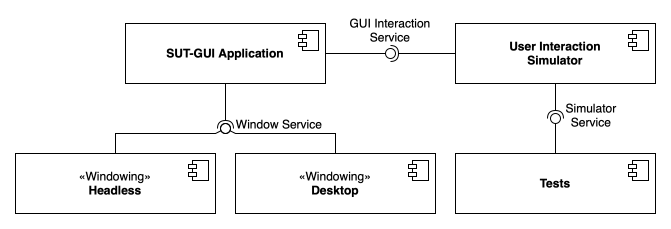

# Eos – Headless JavaFX Testing Framework for Education

[](https://doi.org/10.1109/ASE63991.2025.00393)

## Overview

**Eos** is a headless testing framework tailored for automated testing of JavaFX-based GUI applications in educational environments.
It is specifically designed to work in non-graphical environments such as Continuous Integration pipelines or automated grading systems, enabling seamless dynamic GUI testing without a display server.

## Motivation

Running GUI applications typically requires a graphical environment, which poses a challenge in headless CI/CD and auto-grading pipelines.
Eos addresses this by enabling headless execution and automated interaction with JavaFX applications, while also focusing on didactic feedback for students and usability for instructors.

## Key Objectives

- **Headless Execution**  
  Run JavaFX GUI applications in non-graphical environments without requiring a desktop windowing system.

- **Simulated Interaction**  
  Simulate user interactions such as mouse movement, clicks, and keyboard input to test dynamic behavior.

- **Window Analysis**  
  Verify application behavior by inspecting GUI components after interaction. This includes checking for presence, visibility, and properties of UI elements.

- **Educational Feedback**  
  Generate student-friendly, pedagogically helpful test output to enhance learning.

### Quality Requirements

- **Usability**  
  The framework should offer a simple and intuitive API for instructors, allowing rapid creation of effective GUI tests.

- **Performance**  
  Fast feedback is essential. Test execution time should scale proportionally with test complexity and quantity.

## System Architecture

The architecture of Eos consists of several modular components:



- **SUT-GUI Application**: The student-submitted JavaFX application (System Under Test).
- **Window Service**: Provides the windowing environment. In headless mode, this is implemented using the headless platform of JavaFX instead of the default desktop OS window service.
- **User Interaction Simulator**: A low-level interface to simulate user actions via the GUI framework. It provides a high-level abstraction for interacting with the GUI.
- **Tests**: Instructor-authored test cases using the Simulator Service.

## Implementation

Eos is implemented using the JavaFX framework with the following components:

- **TestFX**: Handles GUI component interaction and state assertions.
- **JavaFX Headless Platform**: Enables headless windowing for JavaFX (built into JavaFX since version 26, Monocle is no longer required).
- **[Ares 2](https://github.com/ls1intum/Ares2)**: Ensures secure and sandboxed test execution.

Eos requires **Java 25** and **JavaFX 26 or newer** (the example uses JavaFX 27).

Eos also provides an instructor-friendly API, featuring pre-built checks and assertion utilities tailored for educational use cases.

## Usage

### Example Setup

An example exercise is provided in the `example` directory:

- `Problem.md`: Contains the exercise description.
- `template/`: Code template provided to students.
- `solution/`: A reference implementation of the correct solution.
- `tests/`: Contains pre-configured, Eos-compatible tests ready for auto-grading and CI execution.

Use the following Docker image in your auto-grader: `ghcr.io/ls1intum/eos:2.0.0`

### Manual Setup

We recommend using the `example` directory as a foundation for creating your own exercises.

If you prefer to set up your project independently, the following is a brief, non-exhaustive overview of the key configuration steps required to integrate Eos manually.
The `example/tests/build.gradle` contains the complete, working setup.

1. Add the dependency and JavaFX (via the `org.openjfx.javafxplugin`, which picks the JARs for the current operating system):

```groovy
dependencies {
    testImplementation 'de.tum.cit.aet:eos:2.0.0'
}

javafx {
    version = '27.0.1'
    // javafx.swing is required by Eos to save screenshots
    modules = ['javafx.base', 'javafx.graphics', 'javafx.controls', 'javafx.swing']
}
```

2. Configure the headless platform within the test task in `build.gradle`:
```groovy
    systemProperty 'glass.platform', 'Headless'
    systemProperty 'prism.order', 'sw'
```

3. Set up **Ares 2** for secure execution: AspectJ weaving of the student code, the Ares agent and the JVM flags, as well as the reserved-package check.
   Refer to the [Ares 2 documentation](https://ls1intum.github.io/Ares2/) for details.
   Use the same Ares version as Eos (currently `2.2.1`).
4. Create a security policy, e.g. `test/SecurityPolicy.yaml`. It has to list your test classes and permit the import of `javafx`:

```yaml
thisPolicyFileCompliesToThePolicyVersion: 1
regardingTheSupervisedCode:
  theFollowingProgrammingLanguageConfigurationIsUsed: JAVA_USING_GRADLE_ARCHUNIT_AND_ASPECTJ
  theSupervisedCodeUsesTheFollowingPackage: "de.tum.cit.aet.javafx.exercise"
  theMainClassInsideThisPackageIs: "ExampleApp"
  theFollowingClassesAreTestClasses:
    - "de.tum.cit.aet.javafx.exercise.ExampleAppTest"
  theFollowingResourceAccessesArePermitted:
    regardingFileSystemInteractions: [ ]
    regardingNetworkConnections: [ ]
    regardingCommandExecutions: [ ]
    regardingThreadCreations: [ ]
    regardingPackageImports:
      - importTheFollowingPackage: "javafx"
    regardingTimeouts: [ ]
```

> ⚠️ The supervised package must not be a prefix of `de.tum.cit.aet.eos` (e.g. do not use `de.tum.cit.aet`), otherwise Eos itself would be treated as student code.

5. Extend your test classes with `JavaFXTest`, reference the policy with `@Policy` and begin writing tests using the Eos and TestFX APIs:

```java
@Policy(value = "test/SecurityPolicy.yaml", withinPath = "classes/java/main/de/tum/cit/aet/javafx/exercise")
public class ExampleAppTest extends JavaFXTest {
    // ...
}
```

`JavaFXTest` already applies `@Public`, `@StrictTimeout(10)` and `@MirrorOutput` from Ares 2 (see `TestFXAnnotations`).

### Writing Tests

Eos offers a set of utilities for common assertions and GUI structure validation. Examples include:

- `captureAndSaveScreenshot(String fileName)`: Saves a screenshot of the current GUI window.
- `checkForCommonVBox(Node... nodes)`: Verifies recursively that the specified nodes are placed inside a common VBox.
- `getNodesOfType(Class<T> type, String query)`: Retrieves all matching nodes of a specific type.
- `getNodeOfType(Class<T> type, String query)`: Retrieves a single matching node or fails the test if zero or multiple matches are found.

Additionally, the [TestFX API](https://testfx.github.io/TestFX/docs/javadoc/) can be used for interactions and more assertions.

### Running Tests

To run tests locally: `./gradlew clean test`

To simulate user interaction with visible UI (non-headless, for local verification): `./gradlew clean testLocally`

> ⚠️ On macOS, `testLocally` needs the Accessibility permission for the app that starts Gradle (e.g. your terminal or IDE): System Settings → Privacy & Security → Accessibility. Without it, the window opens but macOS drops the simulated keyboard and mouse input, so the tests fail (e.g. a label still shows its initial text). Restart the app after granting the permission. The headless `test` task does not need it.

### Migrating from Eos 1.x

Eos 1.x shipped a fork of Ares 1, which is based on the Java Security Manager and therefore does not work on current Java versions.
Eos 2.x uses Ares 2 and Java 25:

- Imports change from `de.tum.in.test.api` to `de.tum.cit.ase.ares.api`.
- The security annotations of Ares 1 (`@WhitelistPath`, `@WhitelistClass`, `@AddTrustedPackage`, `@TrustedThreads`, ...) do not exist anymore and are replaced by a security policy referenced with `@Policy`.
  `TestFXMacAnnotations` was removed, OS-specific path whitelisting is no longer required.
- Monocle was replaced by the headless platform of JavaFX: use `glass.platform=Headless` instead of `glass.platform=Monocle` and `monocle.platform=Headless`.
- JavaFX is no longer a transitive dependency of Eos, add it with the `org.openjfx.javafxplugin`.
- The Maven group and the Java package changed from `de.tum.cit.ase` to `de.tum.cit.aet`: use `de.tum.cit.aet:eos` and import e.g. `de.tum.cit.aet.eos.JavaFXTest`. Ares 2 keeps its own coordinates (`de.tum.cit.ase:ares`, `de.tum.cit.ase.ares.api`).

See the [Ares 2 migration guide](https://ls1intum.github.io/Ares2/) for details.

#### Docker-Based Execution
For consistent and reproducible test execution, you can run tests using Docker: `docker run -it --rm -v ./:/app -w /app ghcr.io/ls1intum/eos:2.0.0 ./gradlew clean test`

## Citing

If you use Eos in your work, please cite the following paper (see also [CITATION.cff](CITATION.cff)):

> B. Schmitz, "Dynamic Testing of GUI Exercises in Headless Environments," in *2025 40th IEEE/ACM International Conference on Automated Software Engineering (ASE)*, 2025, pp. 4131–4133, doi: [10.1109/ASE63991.2025.00393](https://doi.org/10.1109/ASE63991.2025.00393).

```bibtex
@inproceedings{schmitz2025eos,
  author    = {Schmitz, Benjamin},
  title     = {Dynamic Testing of GUI Exercises in Headless Environments},
  booktitle = {2025 40th IEEE/ACM International Conference on Automated Software Engineering (ASE)},
  year      = {2025},
  pages     = {4131--4133},
  publisher = {IEEE},
  doi       = {10.1109/ASE63991.2025.00393}
}
```
